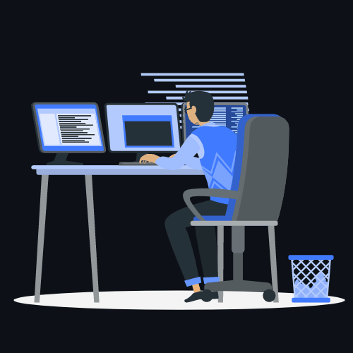

Most projects need three people: one who builds the software, one who understands the network it runs on, and one who makes sure both are secure. I've trained to be all three.

 

<table align="center">
<tr>
<td width="33%" valign="top"><h3>Build</h3>Business software people use every day: web, mobile, Arabic and French, from the first client meeting to go-live.</td>
<td width="33%" valign="top"><h3>Run</h3>Networks and servers that stay up: routing, switching, lab-tested changes and automation in Python.</td>
<td width="33%" valign="top"><h3>Secure</h3>Access that is exactly right, audit trails that answer "who did what", and backups that actually restore.</td>
</tr>
</table>

 

<h3 align="center">Toolbox</h3>

<h3 align="center">Right now</h3>

Full-Stack Developer at <b>MCS Consulting</b>, building business software for client companies 
Master's student at <b>ISI Tunis</b> · works in Arabic, French and English 
Open to new roles where software, network and security meet

 

&nbsp;
&nbsp;
&nbsp;
&nbsp;

Most of my work lives in private client repositories. The public side is on my portfolio.

 

Illustration by <a href="https://storyset.com/web">Storyset</a>

