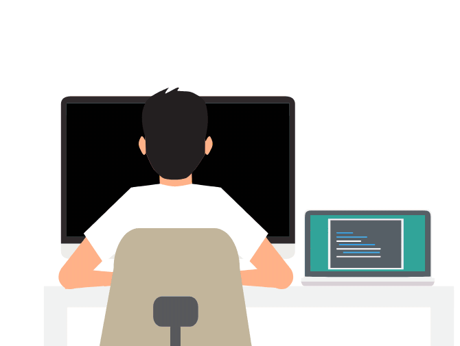

 

 

Most projects need three people: one who builds the software, one who understands the network it runs on, and one who makes sure both are secure. I've trained to be all three.

I came to software through networks. Today I take business systems from the first client meeting to daily use, and I build them knowing where they run, how they can fail, and who will use them on a Monday morning. Most of that work lives in private client repositories; the public side is on my portfolio.

Illustration: “Developer at work” by Emad Moradian, LottieFiles (Lottie Simple License).
