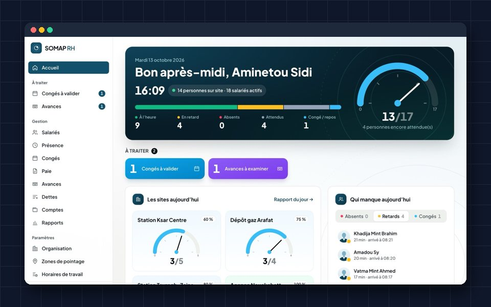
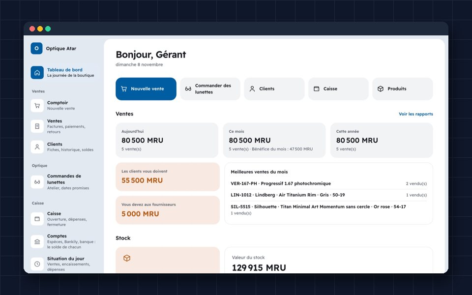
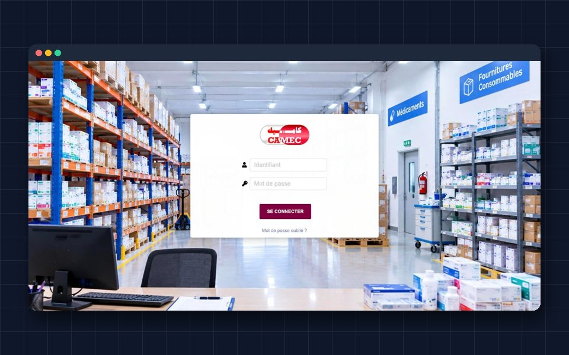
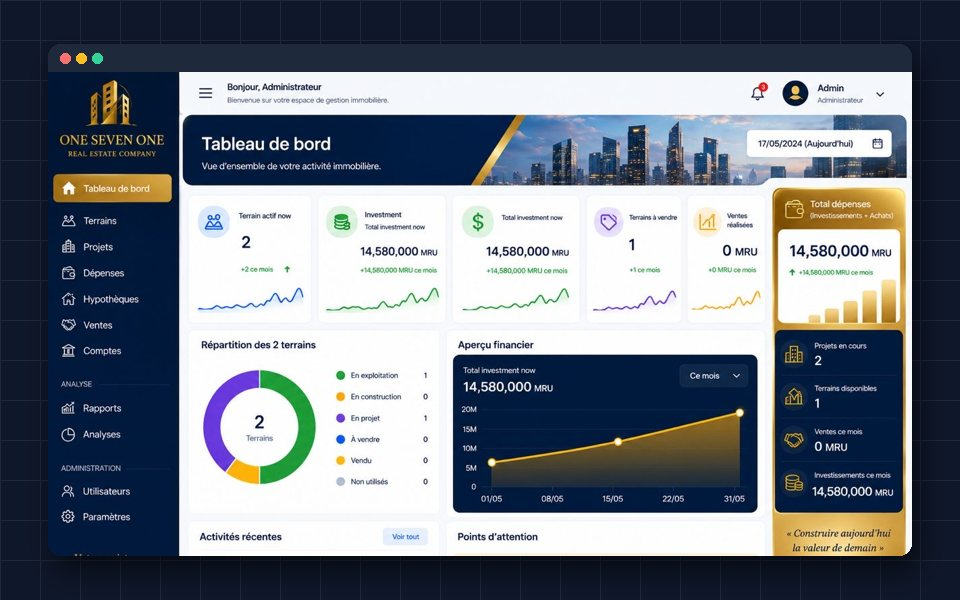
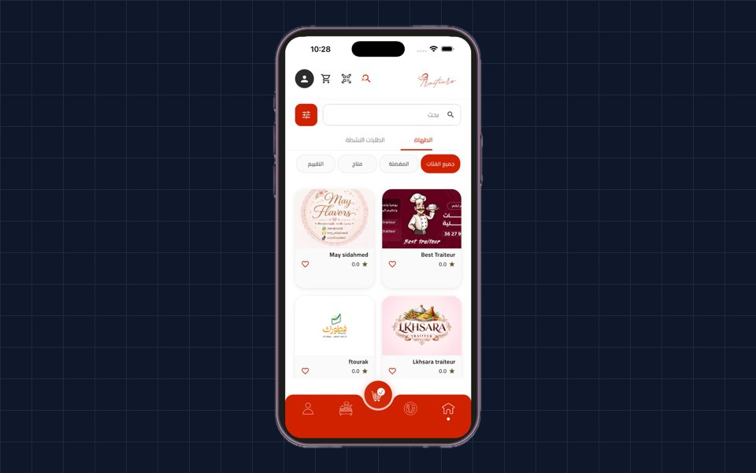
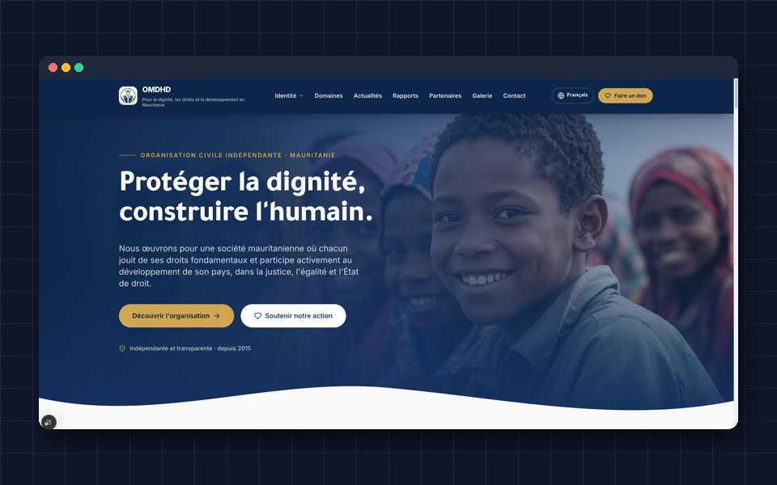

 

 

> **Most projects need three people:** one who builds the software, one who understands the network it runs on, and one who makes sure both are secure. **I've trained to be all three.**

I came to software through networks. Today I take business systems from the first client meeting to daily use, and I build them knowing where they run, how they can fail, and who will use them on a Monday morning.

## In production

<table>
<tr>
<td width="33%" valign="top">

<h3>SOMAP RH</h3>
HR and payroll used every day across a national network of fuel stations, gas depots and agencies.
 <a href="https://somap-grh.com">somap-grh.com</a> · HR · Payroll · Attendance
</td>
<td width="33%" valign="top">

<h3>OpticOS</h3>
Subscription software for optical shops: sales, prescriptions, glasses orders, stock and cash, in French and Arabic.
 <a href="https://opticos-mr.com">opticos-mr.com</a> · SaaS · Multi-shop · RTL
</td>
<td width="33%" valign="top">

<h3>CAMEC</h3>
International order tracking for Mauritania's central medicines agency, replacing Excel with a guided process and alerts.
 <a href="https://camec-mr.com">camec-mr.com</a> · ERP · Public sector
</td>
</tr>
<tr>
<td width="33%" valign="top">

<h3>Land portfolio</h3>
Every parcel, purchase, project, mortgage and sale in one place, with an executive dashboard and reports.
 <a href="https://osn-mr.com">osn-mr.com</a> · Real estate · Reporting
</td>
<td width="33%" valign="top">

<h3>Traiteurs</h3>
Catering and delivery app with Bankily, Masrivi and Sedad mobile payments and live delivery tracking.
 <a href="https://apps.apple.com/mr/app/traiteurs/id6759182605">App Store</a> · iOS · Android
</td>
<td width="33%" valign="top">

<h3>OMDHD</h3>
Official website of a Mauritanian human-rights NGO in Arabic, French and English.
 <a href="https://omdhd.com">omdhd.com</a> · Trilingual · RTL
</td>
</tr>
</table>

Also delivered: custom Dolibarr ERP modules (manufacturing, fleet and fuel), a point-of-sale system, the full payment system of an ISP and software group at **A2 Holding**, and **AutoNetConfig**, a network automation toolkit built at **Moov Mauritel**.

## Toolbox

Plus Dolibarr ERP · Cisco · EVE-NG · Playwright · GitHub Actions

## How I work

Tools change, and with AI they change faster than ever. My foundation doesn't:

- **Data** stays correct, years later.
- **Money** is counted exactly once.
- **Access** is exactly right for each role.
- **Backups** can actually be restored.
- **Releases** never go out before they have been checked.

## Right now

- **Full-Stack Developer** at **MCS Consulting**, delivering business software for clients in Mauritania.
- **Master's in Information Systems & Infrastructure Security** at **ISI Tunis**.
- Working in **Arabic, French and English**, in code and in front of clients.

 

**Open to roles where someone needs to hold the whole thing together: software, network and security.**

[Portfolio](https://abdellahiahmed.vercel.app) · [LinkedIn](https://www.linkedin.com/in/abdellahiahmedahmedbaba/) · [Email](mailto:abdellahiahmedahmedbaba@gmail.com) · Nouakchott, Mauritania · Tunis, Tunisia

